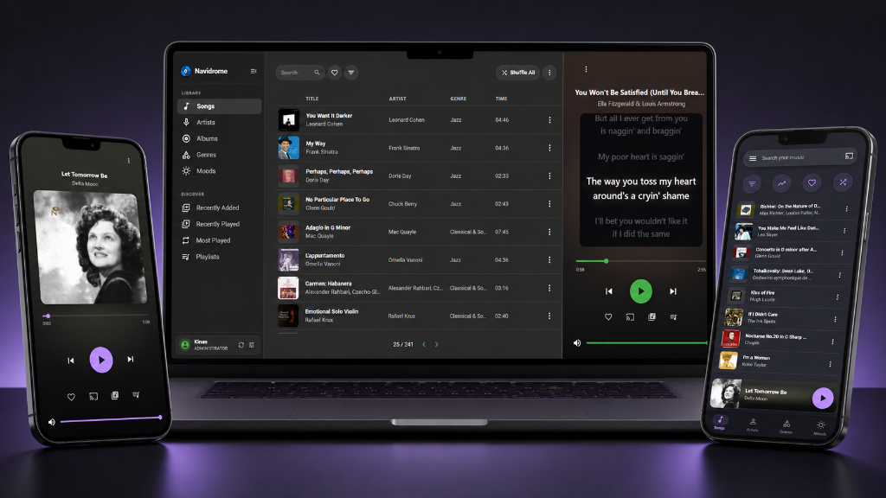

# Bragi



**Bragi** is a self-hosted music streaming server with a web player and an Android app. Keep your music on your own server and listen from your computer, phone, or Cast speakers.

## Features

 **Music library**<br>
Browse and search songs, albums, artists, genres, and moods. Create playlists, save favorites, and manage your playback queue.

 **Lyrics**<br>
Follow synchronized lyrics, tap a timed line to jump to it, and search online for missing lyrics using the song's title and artist.

 **Lyrics editing**<br>
Import TXT or LRC files, edit lyrics, and shift timestamps earlier or later in one-second steps. Save lyrics inside the song file or as a separate file.

 **Song editing**<br>
Update titles, artist names, album artist names, genre and mood tags, and cover artwork.

 **Google Cast**<br>
Play music on Chromecast, Google Home/Nest speakers, and Android TVs from the Android app or a supported browser.

 **Listening statistics**<br>
See your top tracks and artists over the last 30 days and discover unplayed songs.

 **Mobile listening**<br>
The Android app supports background playback, lock-screen controls, and headset controls.

 **Personalization**<br>
Choose a theme and language, adjust library views, and enable Last.fm or ListenBrainz scrobbling when configured on your server.

Online lyrics search and editing require an administrator account and the deployment option shown below. The server needs internet access for lyrics search.

## Deploy with Docker Compose

You need Docker with Docker Compose on your server. The container image is built for **linux/amd64** (Intel/AMD 64-bit servers).

1. Save the following as `compose.yaml`, replacing `/path/to/data` and `/path/to/music` with your own folders. The data folder stores Bragi's database and settings; the music folder contains your collection.

```yaml
services:
  bragi:
    image: ghcr.io/kinanqaz/bragi:latest
    container_name: bragi
    environment:
      BR_ENABLEMEDIAFILEMETADATAEDITING: "true" # (Optional: enable administrator song, artwork, and lyrics editing and lyrics search)
      BR_ENABLEMEDIAFILEDELETION: "true" # (Optional: allow administrators to permanently delete music files)
      BR_CASTMEDIABASEURL: "http://YOUR_SERVER_IP:4533" # (Optional: use a server address reachable by Cast speakers or TVs; replace YOUR_SERVER_IP)
    volumes:
      - /path/to/data:/data
      - /path/to/music:/music:rw
    ports:
      - "4533:4533"
    restart: unless-stopped
```

2. From the folder containing `compose.yaml`, start Bragi:

```sh
docker compose up -d
```

3. Open `http://YOUR_SERVER_IP:4533/app/` in your browser and create your administrator account. Your music will appear as the library is scanned.

The example enables administrator editing, lyrics search, and permanent file deletion. Replace `YOUR_SERVER_IP` with an address your Cast speakers or TVs can reach, or remove `BR_CASTMEDIABASEURL` if no override is needed. Saving changes and deleting files require write access to the music folder. For a read-only library, set both `BR_ENABLEMEDIAFILEMETADATAEDITING` and `BR_ENABLEMEDIAFILEDELETION` to `"false"` and change `:rw` to `:ro`.

## Android app

1. Download the APK from the [latest Android release](https://github.com/Kinanqazan/Bragi/releases/latest) to your phone and install it. Allow installation from that source if Android asks.
2. Open Bragi and enter your server's base address, such as `https://music.example.com` or `http://192.168.1.100:4533` on your home network.
3. Connect and sign in with your Bragi account.

The Android app connects to your server to browse and stream your music.

## Acknowledgements & License

Bragi is based on [Navidrome](https://github.com/navidrome/navidrome) by Deluan and contributors. Licensed under the [GNU General Public License v3](LICENSE).
